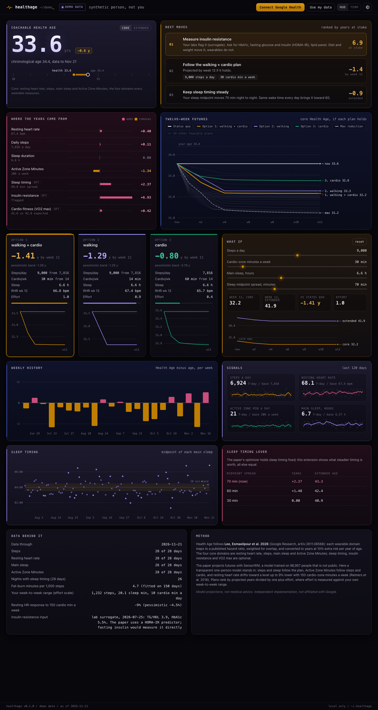
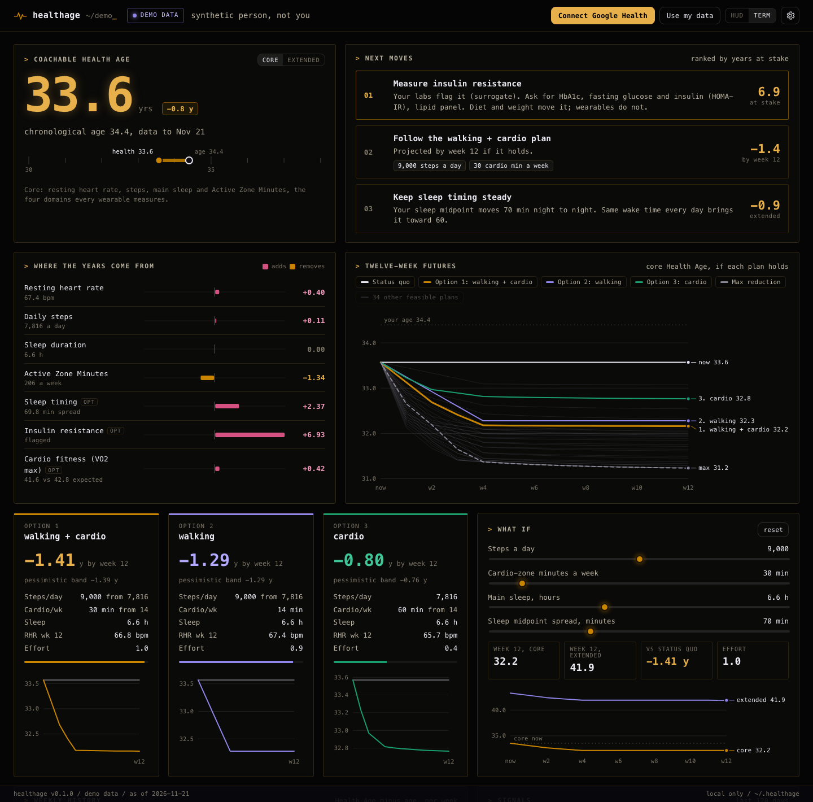
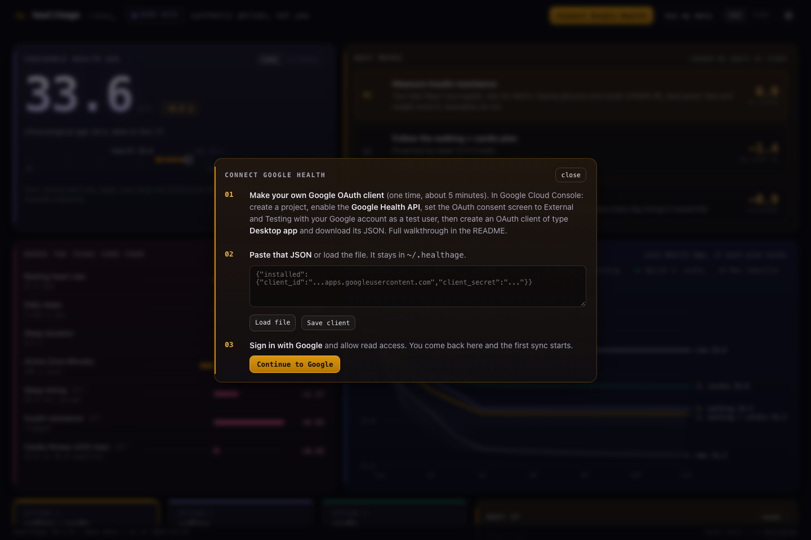

# healthage

**Your Coachable Health Age from your own wearable data, and the twelve-week plans that would lower it.** Runs on your computer, talks only to Google, needs nothing but Python.



healthage implements the health-age measure and coaching optimizer from Google Research's 2026 paper [*Personalized coaching via coachable health age and counterfactual wearable trajectories*](https://arxiv.org/abs/2611.08568) (Lee, Esmaeilpour et al.) and points it at your own Google Health / Fitbit data:

- **Coachable Health Age.** Resting heart rate, daily steps, main sleep and Active Zone Minutes, each mapped to a published hazard ratio and expressed in years. Optional domains switch on when you have them: sleep timing, insulin resistance (from labs) and VO2 max.
- **Where the years come from.** Each domain's contribution, signed.
- **Twelve-week futures.** Your status quo against every candidate plan of steps, sleep and cardio minutes, ranked the paper's way: projected years divided by one plus effort, where effort is measured against *your own* week-to-week range.
- **What if.** Drag steps, cardio, sleep and sleep timing; see Health Age at week 12.
- **History and signals.** Weekly Health Age, 120-day trends, and a clock strip of when you actually sleep.

Two themes, HUD and terminal:



## Quick start

Needs Python 3.9 or newer. No packages to install.

```bash
git clone https://github.com/tanishhky/healthage
cd healthage
python3 -m healthage
```

or install the `healthage` command:

```bash
pipx install git+https://github.com/tanishhky/healthage     # or: pip install git+https://github.com/tanishhky/healthage
healthage
```

A browser tab opens at `http://127.0.0.1:8765`. Click **Explore the demo** to see everything on a synthetic person, or **Connect Google Health** for your own data.

## Connect Google Health

Google Health data is private to you, so you use your own Google Cloud OAuth client. It is free and takes about five minutes, once.

1. Open [Google Cloud Console](https://console.cloud.google.com/) and create a project (any name).
2. **APIs & Services → Library**: search for **Google Health API** and click **Enable**.
3. **Google Auth Platform** (the OAuth consent screen): choose **External**, give the app a name and your email, and under **Audience** leave it in **Testing** and add your own Google account as a **test user**.
4. **Clients → Create client**: application type **Desktop app**. Create it, then **Download JSON**.
5. In healthage: **Connect Google Health**, paste the JSON (or load the file), **Save client**, then **Continue to Google**. Google will say the app is unverified; that is your own app, so continue and allow read access.

You land back on the dashboard and the first sync runs (120 days by default, about half a minute). Then open **Settings** and add your date of birth; labs are optional.

Notes:
- While the consent screen is in Testing, Google expires the connection after 7 days. When that happens healthage says so; click **Connect Google Health** again.
- The redirect URI is `http://127.0.0.1:8765/oauth/callback` (shown in Settings). Desktop-app clients accept any loopback port, so nothing to register.
- Built and tested against the Google Health API v4 with a Fitbit Air, November 2026. Data from other sources that sync into Google Health (Pixel Watch, Health Connect, HealthKit) shows up too; healthage flags when resting heart rate came from more than one device, since devices can read a few bpm apart.



## How Health Age is computed

For each domain *i*, the paper maps your value to a log hazard ratio, scales it by an overlap weight *wᵢ*, and converts risk to years with a Gompertz rate of 10% per year of age:

```
Health Age = age + (1 / 0.1) × Σ wᵢ · log HRᵢ          (floor 18)
```

| Domain | Reference (0 years) | Weight | Source of the hazard ratios |
|---|---|---|---|
| Resting heart rate | 60 bpm or lower | 0.7066 | incident heart failure |
| Daily steps | 8,000; no gain past 9,000 | 0.4773 | incident diabetes |
| Main sleep | 6 to 9 hours | 0.8790 | cardiovascular disease (U-shaped) |
| Active Zone Minutes | under 115 a week counts 0; gains up to 500 | 0.6950 | cardiovascular disease |
| Sleep timing (optional) | midpoint spread 30 min or less | 1 | cardiovascular disease |
| Insulin resistance (optional) | absent | 1 | HR 2.0 |
| VO2 max (optional) | FRIEND registry expected value | 1 | mortality per MET |

All formulas are in [`healthage/engine.py`](healthage/engine.py), and the tests check them against the numbers printed in the paper (its worked example of a 29-year-old with Health Age 26.0, and every published cap).

**Twelve-week plans.** Candidates are grids of daily steps, main sleep and cardio-zone minutes a week. Each is projected 12 weeks ahead, compared with your status quo, and ranked by `benefit / (1 + effort)`; plans worth less than 0.1 years are dropped. Only behaviours are ever targets; resting heart rate and Health Age are outcomes (the paper's action-outcome firewall).

### Where this differs from the paper

- **The world model is replaced.** The paper projects futures with SensorWM, a model trained on 96,957 people that is not public. healthage uses a transparent single-person model: steps and sleep follow the plan (four-week ramp), Active Zone Minutes follow steps (fat-burn rate fitted on your own days) and cardio minutes (credited double, as Fitbit does), and resting heart rate moves 20% of the way each week toward a level up to 9% lower at 150 cardio-zone minutes a week ([Reimers, Knapp & Reimers 2018](https://pmc.ncbi.nlm.nih.gov/articles/PMC6306777/), men, endurance training; 4.5% is shown as the pessimistic band). Weight loss also lowers resting heart rate and is not modelled, so projections lean conservative.
- **Insulin resistance** uses your labs as a surrogate (triglyceride to HDL ratio of 3 or more, or HbA1c of 5.7% or more) unless you set a measured value. The paper uses a HOMA-IR-trained predictor.
- **Extensions, labelled in the UI:** redundant targets are pruned (the paper reports plans that added steps for no gain), the movement pathway is split into walking, cardio and both, and a sleep-timing lever shows what steadier sleep is worth, since the paper's optimizer holds timing fixed.

## Privacy and security

- Everything stays in `~/.healthage` (set `HEALTHAGE_HOME` to move it), files readable only by you. **Delete all local data** in Settings removes it.
- The only network calls go from your computer to Google's OAuth and Health API endpoints. No analytics, no CDN, no fonts or scripts from anywhere else.
- The server listens on 127.0.0.1 only, rejects requests for any other host name (DNS rebinding), requires a custom header on every state-changing request (cross-site requests cannot send it), serves no CORS headers and sets a strict Content-Security-Policy.
- Sign-in uses OAuth with PKCE and a state check; the client secret is yours and never leaves your machine.

## Development

```bash
python3 -m unittest discover -s tests -v      # 26 tests, standard library only
python3 -m healthage --no-browser --verbose
```

Layout: `engine.py` (Health Age, projections, optimizer), `google_health.py` (API client and extractors), `oauth.py`, `server.py`, `demo.py` (synthetic person), `web/` (UI, plain JS and SVG).

## Limits

These are model projections from population studies, not a diagnosis or a forecast for you. Not medical advice. healthage is an independent implementation and is not affiliated with or endorsed by Google or the paper's authors.

## License

MIT
